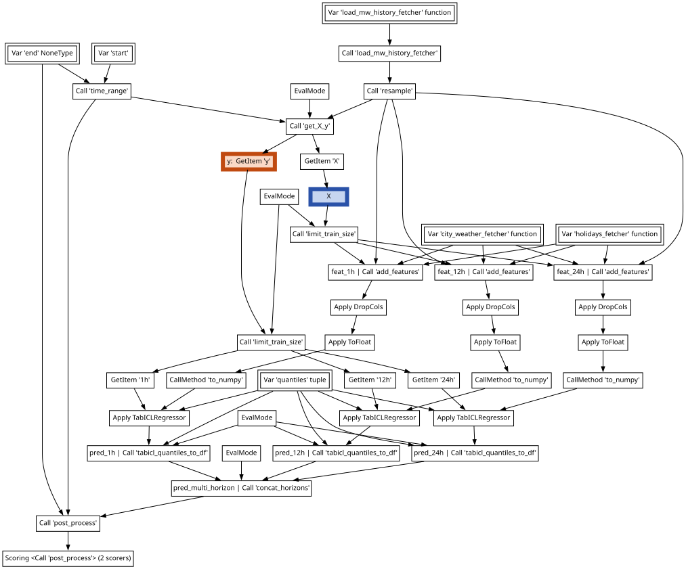

## `whoami`  {visibility="visible"}

::: {.incremental}


- I am a research engineer at Inria as part of the SODA team and the P16 project, 
and I am the lead developer of skrub {width=250}

- I hold a PhD in Computer Science and I have been working mostly on tabular data
processing, cleaning and retrieval. 

:::

## Data science is hard! 

Why is that? 

- **Data Exploration** requires time and effort. 
- **Data Preparation** is often about repeating the same cleaning steps on new data.
- **Data Leakage** needs to be accounted for at all times. 

## {.smaller}

:::: {.columns}

::: {.column width="44%"}

**Textbook ML**

<br>

$X \in \mathbb{R}^{n \times p},\ y \in \mathbb{R}^n$

$\hat{y} = f_{\hat{\theta}}(X)$

<br>

```{=html}
<pre><code class="language-python">estimator = <span style="outline: 3px transparent; outline-offset: 1px;">TabICLRegressor()</span>

cross_validate(estimator, X, y)

estimator.fit(X_train, y_train)
estimator.predict(X_new)</code></pre>
```
:::

::: {.incremental}
::: {.column width="55%"}
**Data-Science Practice**


:::
:::

::::

## 
Let's not get ahead of ourselves! 

The rest of this talk: 


- **Data Exploration**: `skrub.TableReport` 
- **Data Preparation**: `skrub.TableVectorizer`, `skrub.tabular_pipeline` and more
- **Data Leakage**, **transforming new data**: Data Ops

## Data Exploration: the `TableReport`

## Data Preparation

- Cleaner
- TableVectorizer
- `tabular_pipeline` (with TabICL!)
- ApplyToCols
- SessionEncoder

## Data Ops

Example of the sklearn pipeline and what is covered 

Example of a more advanced pipeline

Example of the multi-table situation 

Show again the computational graph of the data ops


## {.smaller}

:::: {.columns}

::: {.column width="44%"}

**Textbook ML**

<br>

$X \in \mathbb{R}^{n \times p},\ y \in \mathbb{R}^n$

$\hat{y} = f_{\hat{\theta}}(X)$

<br>

```{=html}
<pre><code class="language-python">estimator = TabICLRegressor()

cross_validate(estimator, <span style="outline: 3px solid #2a52a8; outline-offset: 1px;">X</span>, <span style="outline: 3px solid #c04a10; outline-offset: 1px;">y</span>)

estimator.fit(X_train, y_train)
estimator.predict(X_new)</code></pre>
```
:::

::: {.column width="55%"}
**Data-Science Practice**


:::

::::

## {.smaller}

:::: {.columns}

::: {.column width="44%"}

**Textbook ML**

<br>

$X \in \mathbb{R}^{n \times p},\ y \in \mathbb{R}^n$

$\hat{y} = f_{\hat{\theta}}(X)$

<br>

```{=html}
<pre><code class="language-python">estimator = <span style="outline: 3px solid blue; outline-offset: 1px;">TabICLRegressor()</span>

cross_validate(estimator, X, y)

estimator.fit(X_train, y_train)
estimator.predict(X_new)</code></pre>
```
:::

::: {.column width="55%"}
**Data-Science Practice**


:::

::::

## 
**Data wrangling:** filtering, resampling, aggregations, joins, ...

- Cross-validate without [**data leaks**]{style="color: #1a5a8a; font-weight: bold;"}.
- [**Tune choices**]{style="color: #1a5a8a; font-weight: bold;"} with validation scores.
- Replay on [**new inputs**]{style="color: #1a5a8a; font-weight: bold;"}.

::: {.callout-note icon=false style="font-size: 1em;"}
### DataOps

- All the goodies of the scikit-learn framework: `fit()` & `predict()`, cross-validation, hyperparameter tuning, serialization.
- Without the usual restrictions & while supporting **arbitrary data processing**.
  [Multiple inputs, feature & target construction, filtering samples, dynamic arguments for CV splitters & scorers, etc.]{style="font-size: 0.8em; color: gray;"}
- And more: Optuna integration, dynamic previews, pipeline inspection, ...
:::

## Basic example {.smaller}

Declare the pipeline

```python
data_path = skrub.var("data_path")
data = data_path.skb.apply_func(pd.read_csv)
X = data.drop(columns="target", errors="ignore").skb.mark_as_X()
y = data["target"].skb.mark_as_y()
pred = X.skb.apply(StandardScaler()).skb.apply(LogisticRegression(), y=y)
```

Cross-validate

```python
pred.skb.cross_validate({"data_path": "historical_data.csv"})
```

Make a "learner" (object with `fit()` & `predict()`)

```python
learner = pred.skb.make_learner().fit({"data_path": "historical_data.csv"})
learner.predict({"data_path": "new_data.csv"})
```

##


## Hyperparameter tuning

```{=html}
<ul style="font-size: 0.8em;">
<li>Replace any value with a choice:</li>
</ul>
<pre style="font-size: 0.55em; background-color: #f5f5f5; padding: 0.6em 1em; margin: 0.8em 0;"><code style="background-color: inherit;"> X = data.drop(columns="target", errors="ignore").skb.mark_as_X()
 y = data["target"].skb.mark_as_y()
 pred = X.skb.apply(StandardScaler()).skb.apply(
<span style="color: #c00; background-color: #fff0f0;">-    LogisticRegression(<span style="background-color: #f9a0a0;">C=1.0</span>),</span>
<span style="color: #080; background-color: #f0fff0;">+    LogisticRegression(<span style="background-color: #9be99b;">C=skrub.choose_float(0.1, 10.0, log=True)</span>),</span>
     y=y)</code></pre>
<ul style="font-size: 0.8em;">
<li>Use grid search or randomized search (possibly backed by Optuna).</li>
</ul>
<pre style="font-size: 0.55em; background-color: #f5f5f5; padding: 0.6em 1em; margin: 0.8em 0;"><code style="background-color: inherit;"><span style="color: #c00; background-color: #fff0f0;">-learner = pred.skb.<span style="background-color: #f9a0a0;">make_learner</span>().fit({...})</span>
<span style="color: #080; background-color: #f0fff0;">+learner = pred.skb.<span style="background-color: #9be99b;">make_randomized_search</span>().fit({...})</span></code></pre>
```
